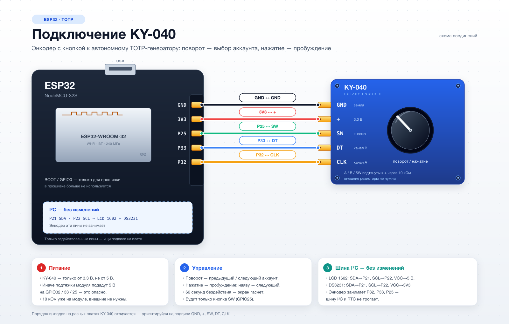

# ESP32 TOTP Authenticator

Автономный **офлайн-генератор одноразовых паролей** (TOTP, RFC 6238) на ESP32. Показывает 6-значные коды 2FA для твоих аккаунтов — без интернета, с точным временем от модуля часов DS3231. Управление — энкодер **KY-040**: поворот выбирает аккаунт, нажатие будит экран.

> Полный аналог аппаратных токенов (RSA SecurID / YubiKey TOTP), собранный на ESP32 + LCD 1602 + KY-040.

---

## Оглавление

- [Возможности](#возможности)
- [Железо](#железо)
- [Схема подключения (шпаргалка)](#схема-подключения-шпаргалка)
- [Как это работает](#как-это-работает)
- [Сборка и прошивка](#сборка-и-прошивка)
- [Секреты (конфигурация)](#секреты-конфигурация)
- [Использование](#использование)
- [Настройка Wi-Fi и синхронизация времени](#настройка-wi-fi-и-синхронизация-времени)
- [Питание и энергоэффективность](#питание-и-энергоэффективность)
- [Миграция аккаунтов из Google Authenticator](#миграция-аккаунтов-из-google-authenticator)
- [Структура проекта](#структура-проекта)
- [Устранение неполадок](#устранение-неполадок)

---

## Возможности

- 🔐 **TOTP (RFC 6238)** — HMAC-SHA1, стандартные 6-значные коды.
- 🕒 **Автономное время** — берётся с RTC DS3231 (UTC), без Wi-Fi/NTP.
- 📟 **Дисплей 1602**: название аккаунта + код + индикатор оставшегося времени.
- 📜 **Бегущая строка** — если название аккаунта длиннее 16 символов.
- 🎛️ **Энкодер KY-040** — поворот переключает аккаунты; нажатие будит экран, а наяву — переключает на следующий.
- 📶 **Wi-Fi provisioning + NTP** — Wi-Fi-пароль вводится с телефона через ESP BLE Provisioning; время синхронизируется по NTP, на LCD — песочные часы и коррекция.
- 💤 **Автосон** — экран гаснет через 30 секунд бездействия; будит кнопка энкодера.
- 🔒 **Секреты не светятся** — хранятся в файле, помеченном в `.gitignore`.

---

## Железо

| Компонент | Описание | Адрес I²C |
|---|---|---|
| **ESP32** | Плата NodeMCU-32S, 38 пинов | — |
| **LCD 1602A** | Дисплей 16×2 (HD44780) + I2C-модуль PCF8574 | `0x27` |
| **DS3231** | Модуль часов реального времени (с батарейкой CR2032) | `0x68` |
| **KY-040** | Энкодер с кнопкой (CLK / DT / SW) | — (GPIO) |
| **Battery Shield** | Питание 5 В на шины макетки | — |

> На модуле DS3231 также есть EEPROM AT24C32 (адрес `0x57`) — она не используется.

---

## Схема подключения (шпаргалка)

⚡ **Шины макетки:**
- 🔴 **Красная линия (+)** = `5V` (от Battery Shield).
- 🔵 **Синяя линия (−)** = `GND` (от Battery Shield).
- Левая и правая половинки макетки соединены перемычками.

### ESP32 (NodeMCU)

| Пин ESP32 | Куда |
|---|---|
| **VIN** | → красная линия (5V) |
| **GND** | → синяя линия (GND) |
| **3V3** | → питание DS3231 и KY-040 (⚠️ не 5V) |

### Дисплей 1602 (I2C)

| Пин дисплея | Куда |
|---|---|
| **VCC** | → красная линия (5V) |
| **GND** | → синяя линия (GND) |
| **SDA** | → пин **P21** (GPIO21) |
| **SCL** | → пин **P22** (GPIO22) |

### Часы RTC DS3231

| Пин DS3231 | Куда |
|---|---|
| **VCC** | → **напрямую в пин 3V3** ESP32 (⚠️ не в красную линию!) |
| **GND** | → синяя линия (или GND ESP32) |
| **SDA** | → пин **P21** (параллельно с дисплеем) |
| **SCL** | → пин **P22** (параллельно с дисплеем) |

> 💡 **Важно:** дисплей питается от 5V, а DS3231 и KY-040 — от **3V3**. Дисплей и часы висят на одной шине I²C (SDA=P21, SCL=P22); энкодер занимает отдельные пины P32, P33, P25.

### Энкодер KY-040

| Пин KY-040 | Куда | Примечание |
|---|---|---|
| **GND** | синяя линия (GND) | общий провод |
| **+** | **3V3** ESP32 | ⚠️ только 3.3 В, не 5 В |
| **CLK (A)** | пин **P32** (GPIO32) | канал A |
| **DT (B)** | пин **P33** (GPIO33) | канал B |
| **SW** | пин **P25** (GPIO25) | кнопка; будит из сна |

> ⚠️ **Питание:** KY-040 — только от **3V3**. Если подать 5 В, подтяжки на модуле подадут 5 В на GPIO32/33/25 — это опасно для ESP32. В большинстве модулей подтяжки 10 кОм уже есть; если их нет, скетч включает внутренние подтяжки ESP32 — внешние резисторы всё равно не нужны.

> 💡 **Порядок выводов** на разных платах KY-040 отличается — ориентируйся на подписи `GND`, `+`, `SW`, `DT`, `CLK` на шелкографии.

> ℹ️ **BOOT (GPIO0)** прошивкой больше не используется — остаётся только для входа в режим прошивки.

### Схема



Исходник в SVG: [`docs/ky040-wiring.svg`](docs/ky040-wiring.svg). Схема логическая: показаны только задействованные пины, ищи их на плате по подписям.

---

## Как это работает

1. **Время** — читается с DS3231 (UTC), переводится в Unix-timestamp.
2. **Счётчик** — `counter = unix_time / 30` (код меняется каждые 30 секунд).
3. **Ключ** — base32-секрет декодируется в сырые байты.
4. **HMAC-SHA1** — считается `HMAC-SHA1(секрет, счётчик)`.
5. **6 цифр** — динамическая усечёнка (RFC 4226) из HMAC → код `000000…999999`.

### Что на экране

```
Google: user@example.com     ← строка 1: название (бежит, если длинное)
123456 ████████              ← строка 2: код + индикатор (тает к концу 30 сек)
```

---

## Сборка и прошивка

### Зависимости

| Библиотека | Назначение |
|---|---|
| `LiquidCrystal_I2C` | работа с LCD через PCF8574 |
| `Wire` | I²C (дисплей + RTC) |
| `mbedtls/md.h` (встроенная) | HMAC-SHA1 для TOTP |
| `esp_sleep.h`, `driver/rtc_io.h` (встроенные) | лёгкий сон и пробуждение по SW |
| `WiFiProv`, `WiFi`, `Preferences` (встроенные) | BLE-настройка Wi-Fi, NTP и хранение флагов |

```bash
arduino-cli lib install "LiquidCrystal I2C"
```

Энкодер KY-040 обрабатывается прямо в скетче (прерывания + квадратурный декодер), отдельная библиотека не нужна.

### Прошивка

Плата **ESP32 Dev Module** (ядро 2.0.14). Из-за Wi-Fi/BLE нужна схема разделов **Huge APP (3MB No OTA/1MB SPIFFS)**: в Arduino IDE выбери её в *Tools → Partition Scheme*, а в `arduino-cli` добавь `:PartitionScheme=huge_app`.

```bash
arduino-cli compile --fqbn esp32:esp32:esp32:PartitionScheme=huge_app totp
arduino-cli upload -p /dev/cu.SLAB_USBtoUART --fqbn esp32:esp32:esp32:PartitionScheme=huge_app totp
```

---

## Секреты (конфигурация)

Секретные ключи хранятся в файле `totp/totp_secrets.h` (он в `.gitignore`).

1. Скопируй `totp/totp_secrets.h.example` → `totp/totp_secrets.h`.
2. Впиши свои аккаунты:

```cpp
TotpEntry totpEntries[] = {
  { "Google: user@example.com", "JBSWY3DPEHPK3PXP" },
  { "GitHub: username",         "GEZDGNBVGY3TQOJQ" },
  // ... добавь свои
};
const int TOTP_COUNT = sizeof(totpEntries) / sizeof(totpEntries[0]);
```

- **Первое поле** — произвольное название аккаунта.
- **Второе** — base32-секрет (тот самый, что выдают при настройке 2FA).

> 🔒 Никогда не коммить `totp_secrets.h` — он уже в `.gitignore`.

---

## Использование

| Действие | Результат |
|---|---|
| **Поворот энкодера** | предыдущий / следующий аккаунт |
| **Нажатие SW** (из сна) | пробуждение; аккаунт не меняется |
| **Нажатие SW** (наяву) | следующий аккаунт |
| **Удержание SW 3 сек** | вход в настройку Wi-Fi / повторная синхронизация |
| **30 сек без действий** | экран гаснет (лёгкий сон) |

- Прокрутка в режиме сна **не будит** — сначала нажми кнопку.
- Если направление прокрутки не нравится, поменяй `ENCODER_DIRECTION` на `-1` в `totp/totp.ino`.
- Если один щелчок не переключает аккаунт (или перескакивает через один), подстрой `ENC_TICKS_PER_DETENT`. Сейчас стоит `2` — один щелчок = один аккаунт; если начнёт перескакивать, верни `4`.

Свери код на дисплее с кодом в Google Authenticator — они должны совпадать.

---

## Настройка Wi-Fi и синхронизация времени

Время берётся с DS3231. Раз в сутки (или если RTC сброшен) ESP32 поднимает Wi-Fi, синхронизирует время по NTP и снова полностью уходит в офлайн. Wi-Fi-пароль вводится один раз через **ESP BLE Provisioning** с телефона.

### Первая настройка

1. Включи плату. На LCD появится:
```
WIFI SETUP
[⏳] PROV_XXXXXX
```
и периодически:
```
POP 12345678
```
2. Открой **ESP BLE Provisioning** на iPhone/Android.
3. Найди устройство `PROV_XXXXXX`, введи POP с экрана (8 цифр).
4. Выбери свою Wi-Fi-сеть и введи пароль.
5. Плата подключится, возьмёт время по NTP и покажет:
```
RTC SYNCED
CORR +3s
```
Затем перезагрузится в обычный режим.

`CORR +3s` — на сколько секунд RTC отставал/спешил. Если RTC был сброшен — `TIME SET`.

### Повторная настройка / смена Wi-Fi

- **Удержание кнопки 3 секунды** в обычном режиме → `SETUP MODE` → перезагрузка в BLE-настройку.
- **Удержание кнопки при включении/Reset** → сразу BLE-настройка (аварийный путь).
- При ошибке Wi-Fi/NTP на экране `HOLD 3s SETUP` — удержание кнопки запускает настройку заново.
- Во время BLE-настройки удержание кнопки 3 секунды отменяет её и возвращает обычный режим.

При каждой настройке старые Wi-Fi-credentials стираются, генерируется новый POP.

### Что происходит с Wi-Fi

- Wi-Fi включается только на время настройки/синхронизации.
- После успешной записи времени плата перезагружается и работает офлайн.
- Если Wi-Fi/NTP не удался — показывается ошибка, затем обычный режим с текущим временем RTC; повторная настройка — удержанием кнопки.
- В DS3231 время хранится в **UTC**; часовой пояс телефона/роутера на TOTP не влияет.

> ⚠️ Для BLE-настройки нужно приложение **ESP BLE Provisioning** на телефоне. Официального приложения для macOS нет.

> ⚠️ Прошивка с Wi-Fi/BLE занимает ~1.56 МБ, поэтому нужна схема разделов **Huge APP (3MB No OTA/1MB SPIFFS)**.

---

## Питание и энергоэффективность

| Режим | Ток |
|---|---|
| Активен (показывает код) | ~110–130 мА |
| Сон (лёгкий) | ~20–25 мА |

- От **18650 на 3500 мАч** — около **6–7 дней** (доминирует ток сна).
- Потолок задаёт обвязка dev-платы: **CP2102** (USB-serial, ~15–20 мА) и **AMS1117** (регулятор, ~5–10 мА) едят ток даже в сне.
- Во время BLE-настройки и NTP радио потребляет больше; после синхронизации Wi-Fi/BLE выключаются, и устройство снова работает офлайн.

### Как продлить автономность

1. Отключить/отпаять **CP2102** или взять голый модуль ESP32-WROOM → недели.
2. **Deep sleep** вместо light sleep (SW на GPIO25 — RTC-пин, `ext0` подойдёт; но после deep sleep скетч стартует заново).
3. LDO с низким током покоя вместо AMS1117.
4. Несколько 18650 параллельно.

---

## Миграция аккаунтов из Google Authenticator

В проекте есть утилиты (Python) для переноса аккаунтов:

1. **`decode_qr.py`** — декодирует QR-код экспорта (нужен `opencv-python`):
   ```bash
   python3 decode_qr.py ~/Downloads/photo.jpg
   ```
2. **`unpack_migration.py`** — распаковывает `otpauth-migration://` в список аккаунтов:
   ```bash
   python3 decode_qr.py photo.jpg | python3 unpack_migration.py
   ```
   На выходе — название и `secret (base32)` для каждого аккаунта. Их вписываешь в `totp_secrets.h`.

> Оба скрипта печатают результат только в локальный терминал, ничего не отправляют.

---

## Структура проекта

| Путь | Назначение |
|---|---|
| `totp/totp.ino` | **Основная прошивка** (TOTP-генератор) |
| `totp/totp_secrets.h.example` | Шаблон секретов |
| `totp/totp_secrets.h` | Твои секреты (в `.gitignore`) |
| `docs/ky040-wiring.svg` | Векторная схема подключения KY-040 |
| `docs/ky040-wiring.png` | Растровая версия схемы для README |
| `docs/gen_ky040_wiring.py` | Генератор схемы |
| `decode_qr.py` | Декодирование QR экспорта |
| `unpack_migration.py` | Распаковка `otpauth-migration://` |
| `i2c_scan/` | Сканер устройств на шине I²C |
| `rtc_set/` | Установка времени DS3231 |

---

## Устранение неполадок

| Симптом | Причина / решение |
|---|---|
| Код не совпадает с телефоном | Время на DS3231 уплыло → удерживай кнопку 3 с и перепроведи BLE-настройку/NTP; или опечатка в base32-секрете |
| Экран пустой, подсветка есть | Покрути синий потенциометр (контраст) |
| Дисплей не найден в I²C | Проверь VCC→5V, GND, SDA→P21, SCL→P22 (сканер: `i2c_scan`) |
| Часы не видны | DS3231 должен быть на **3V3**, адрес `0x68` |
| Подсветка мерцает | Программный ШИМ; здесь подсветка просто вкл/выкл |
| Экран не просыпается по кнопке | SW должен быть на **P25**; кнопка замыкает SW на GND. Проверь `+`→3V3 и общий GND |
| После прошивки экран погас и не будится | Без подключённого KY-040 будить нечем: нажми **EN/Reset** или подключи SW→P25 |
| Прокрутка не переключает аккаунт | Проверь CLK→P32, DT→P33 и питание 3.3 В; подстрой `ENC_TICKS_PER_DETENT` |
| Поворот работает в обратную сторону | Поменяй `ENCODER_DIRECTION` на `-1` в `totp.ino` |
| Кнопка срабатывает дважды | Увеличь `DEBOUNCE_MS` или добавь 100 нФ между SW и GND |
| Плата не появляется в ESP BLE Provisioning | Удерживай кнопку 3 с или при старте; проверь, что телефон видит `PROV_...`; перезагрузи плату |
| Ошибка `AUTH ERROR` | Неверный Wi-Fi-пароль; удерживай кнопку 3 с и повтори настройку |
| После настройки всё равно нет времени | Проверь интернет на Wi-Fi; при ошибке NTP удерживай кнопку 3 с и повтори |
