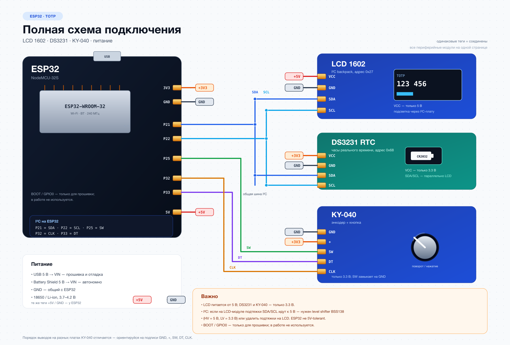

# ESP32 TOTP Authenticator

Автономный **офлайн-генератор одноразовых паролей** (TOTP, RFC 6238) на ESP32. Показывает 6-значные коды 2FA с точным временем от DS3231. Управление — энкодер **KY-040**, настройка — через **SoftAP-портал** с телефона или компьютера. Секреты хранятся в NVS и нигде не отображаются.

> Аппаратный токен на ESP32 + LCD 1602 + KY-040. Wi-Fi используется только для настройки и необязательной синхронизации времени по NTP.

---

## Оглавление

- [Возможности](#возможности)
- [Железо](#железо)
- [Схема подключения (шпаргалка)](#схема-подключения-шпаргалка)
- [Как это работает](#как-это-работает)
- [Сборка и прошивка](#сборка-и-прошивка)
- [Аккаунты (NVS и портал)](#аккаунты-nvs-и-портал)
- [Использование](#использование)
- [Настройка через SoftAP-портал](#настройка-через-softap-портал)
- [Питание и энергоэффективность](#питание-и-энергоэффективность)
- [Миграция аккаунтов из Google Authenticator](#миграция-аккаунтов-из-google-authenticator)
- [Структура проекта](#структура-проекта)
- [Устранение неполадок](#устранение-неполадок)

---

## Возможности

- 🔐 **TOTP (RFC 6238)** — HMAC-SHA1, стандартные 6-значные коды.
- 🕒 **Автономное время** — RTC DS3231 (UTC); Wi-Fi/NTP не обязательны.
- 📟 **LCD 1602** — название аккаунта, код и индикатор оставшегося времени.
- 📜 **Бегущая строка** — если название аккаунта длиннее 16 символов.
- 🎛️ **KY-040** — поворот переключает аккаунты, нажатие будит экран.
- 🗂️ **Аккаунты в NVS** — добавление, удаление и удаление всех с девайса; без перепрошивки.
- 📶 **SoftAP-портал** — Wi-Fi, NTP и TOTP-аккаунты настраиваются в браузере; приложение не нужно.
- ⏱️ **NTP опционален** — автосинхронизация включается/выключается; при старте её можно пропустить.
- 💤 **Автосон** — через 60 секунд бездействия уходит в deep sleep; будит кнопка, при старте восстанавливается последний аккаунт.
- 🔒 **Секреты не светятся** — на LCD, в вебе и в логах только имена; секреты хранятся в NVS.

---

## Железо

| Компонент | Описание | Адрес I²C |
|---|---|---|
| **ESP32** | Плата NodeMCU-32S, 38 пинов | — |
| **LCD 1602A** | Дисплей 16×2 (HD44780) + I2C-модуль PCF8574 | `0x27` |
| **DS3231** | Модуль часов реального времени (с батарейкой CR2032) | `0x68` |
| **KY-040** | Энкодер с кнопкой (CLK / DT / SW) | — (GPIO) |
| **Battery Shield** | Питание 5 В на шины макетки | — |

> На модуле DS3231 также есть EEPROM AT24C32 (адрес `0x57`) — она не используется.

---

## Схема подключения (шпаргалка)

⚡ **Шины макетки:**
- 🔴 **Красная линия (+)** = `5V` (от Battery Shield).
- 🔵 **Синяя линия (−)** = `GND` (от Battery Shield).
- Левая и правая половинки макетки соединены перемычками.

### ESP32 (NodeMCU)

| Пин ESP32 | Куда |
|---|---|
| **VIN** | → красная линия (5V) |
| **GND** | → синяя линия (GND) |
| **3V3** | → питание DS3231 и KY-040 (⚠️ не 5V) |

### Дисплей 1602 (I2C)

| Пин дисплея | Куда |
|---|---|
| **VCC** | → красная линия (5V) |
| **GND** | → синяя линия (GND) |
| **SDA** | → пин **P21** (GPIO21) |
| **SCL** | → пин **P22** (GPIO22) |

### Часы RTC DS3231

| Пин DS3231 | Куда |
|---|---|
| **VCC** | → **напрямую в пин 3V3** ESP32 (⚠️ не в красную линию!) |
| **GND** | → синяя линия (или GND ESP32) |
| **SDA** | → пин **P21** (параллельно с дисплеем) |
| **SCL** | → пин **P22** (параллельно с дисплеем) |

> 💡 **Важно:** дисплей питается от 5V, а DS3231 и KY-040 — от **3V3**. Дисплей и часы висят на одной шине I²C (SDA=P21, SCL=P22); энкодер занимает отдельные пины P32, P33, P25.

### Энкодер KY-040

| Пин KY-040 | Куда | Примечание |
|---|---|---|
| **GND** | синяя линия (GND) | общий провод |
| **+** | **3V3** ESP32 | ⚠️ только 3.3 В, не 5 В |
| **CLK (A)** | пин **P32** (GPIO32) | канал A |
| **DT (B)** | пин **P33** (GPIO33) | канал B |

> 🔘 Кнопка **SW** (GPIO25) показана на [общей схеме](#схема).

> ⚠️ **Питание:** KY-040 — только от **3V3**. Если подать 5 В, подтяжки на модуле подадут 5 В на GPIO32/33/25 — это опасно для ESP32. В большинстве модулей подтяжки 10 кОм уже есть; если их нет, скетч включает внутренние подтяжки ESP32 — внешние резисторы всё равно не нужны.

> 💡 **Порядок выводов** на разных платах KY-040 отличается — ориентируйся на подписи `GND`, `+`, `SW`, `DT`, `CLK` на шелкографии.

> ℹ️ **BOOT (GPIO0)** прошивкой больше не используется — остаётся только для входа в режим прошивки.

### Схема



Исходник в SVG: [`docs/wiring-full.svg`](docs/wiring-full.svg). На схеме все модули: LCD 1602, DS3231, KY-040 и питание. Одинаковые теги `+5V`, `+3V3`, `GND` означают электрическое соединение.

---

## Как это работает

1. **Аккаунты** — имя и base32-секрет хранятся в NVS. При старте загружаются в память.
2. **Время** — читается с DS3231 (UTC), переводится в Unix-timestamp.
3. **Счётчик** — `counter = unix_time / 30` (код меняется каждые 30 секунд).
4. **Ключ** — base32-секрет декодируется в сырые байты.
5. **HMAC-SHA1** — считается `HMAC-SHA1(секрет, счётчик)`.
6. **6 цифр** — динамическая усечёнка (RFC 4226) из HMAC → код `000000…999999`.
7. **NTP** — опционально: при старте или из меню ESP32 подключается к сохранённой Wi-Fi, получает UTC и пишет его в DS3231.

### Что на экране

```
Google: user@example.com     ← строка 1: название (бежит, если длинное)
123456 ████████              ← строка 2: код + индикатор (тает к концу 30 сек)
```

Если аккаунтов нет: `NO ACCOUNTS` / `HOLD 3s MENU`. Если время не установлено: `NO TIME  MENU` — зайди в меню и выбери `Sync time`.

---

## Сборка и прошивка

### Зависимости

| Библиотека | Назначение |
|---|---|
| `LiquidCrystal_I2C` | работа с LCD через PCF8574 |
| `Wire` | I²C (дисплей + RTC) |
| `mbedtls/md.h` (встроенная) | HMAC-SHA1 для TOTP |
| `esp_sleep.h`, `driver/rtc_io.h`, `esp_sntp.h` (встроенные) | сон, пробуждение и NTP |
| `WiFi`, `WebServer`, `DNSServer`, `Preferences` (встроенные) | SoftAP-портал, NTP и NVS |

```bash
arduino-cli lib install "LiquidCrystal I2C"
```

Энкодер KY-040 обрабатывается прямо в скетче (прерывания + квадратурный декодер), отдельная библиотека не нужна. BLE и ESP BLE Provisioning больше не используются.

### Прошивка

Плата **ESP32 Dev Module** (ядро 2.0.14). Прошивка занимает ~820 КБ, поэтому нужна схема разделов **Huge APP (3MB No OTA/1MB SPIFFS)**: в Arduino IDE выбери её в *Tools → Partition Scheme*, а в `arduino-cli` добавь `:PartitionScheme=huge_app`.

```bash
arduino-cli compile --fqbn esp32:esp32:esp32:PartitionScheme=huge_app totp
arduino-cli upload -p /dev/cu.SLAB_USBtoUART --fqbn esp32:esp32:esp32:PartitionScheme=huge_app totp
```

> При первом переходе на новую разметку NVS может очиститься. Чистая прошивка стартует с 0 аккаунтов и сама поднимает портал настройки.

---

## Аккаунты (NVS и портал)

Аккаунты **не вкомпилированы в прошивку**. Они хранятся в NVS в виде имени и base32-секрета. Добавлять и удалять их можно:

- через **SoftAP-портал** (пункт меню `Setup`) — с телефона или компьютера;
- прямо с девайса: меню `Accounts` → удалить аккаунт или `DELETE ALL`.

Ограничения:

- до **16** аккаунтов;
- имя — 1–32 символа;
- секрет — base32, 16–64 символа (можно вставить `otpauth://totp/...` — портал вытащит `secret`).

В вебе и на LCD показываются **только имена**. Секреты не отображаются ни в интерфейсе, ни в Serial-логах. Если секрет утерян — его нужно заново взять из Google Authenticator/бэкапа и добавить как новый аккаунт.

> `totp/totp_secrets.h` и `totp_secrets.h.example` — легаси. Прошивка их больше не использует; файл с реальными секретами можно удалить или оставить как локальный backup. В бинарник он не попадает.

> ⚠️ NVS хранится во flash. Без flash encryption секреты можно вычитать при физическом доступе к плате; это отдельный уровень защиты, не входящий в текущую прошивку.

---

## Использование

| Действие | Результат |
|---|---|
| **Поворот энкодера** | предыдущий / следующий аккаунт |
| **Короткое нажатие** | следующий аккаунт; из сна — пробуждение |
| **Удержание 3 секунды** | меню |
| **60 секунд без действий** | экран гаснет, deep sleep; пробуждение по SW, загрузка ~0,5 с |

Меню:

```
MENU 1/5  > Sync time   — принудительный NTP
MENU 2/5  > Accounts    — список аккаунтов, удаление
MENU 3/5  > Setup       — SoftAP-портал (Wi-Fi, NTP, аккаунты)
MENU 4/5  > Status      — RTC, последняя синхронизация, Wi-Fi, число аккаунтов
MENU 5/5  > Back        — выход
```

- В меню поворот выбирает пункт, короткое нажатие — вход, удержание 3 секунды — выход. Через 15 секунд без действий меню закрывается.
- В `Accounts` поворот выбирает аккаунт или `DELETE ALL`; короткое нажатие — удаление с подтверждением `YES/NO`; удержание — назад в меню.
- Прокрутка в режиме сна **не будит** — сначала нажми кнопку.
- Если направление прокрутки не нравится, поменяй `ENCODER_DIRECTION` на `-1` в `totp/totp.ino`.
- Если один щелчок не переключает аккаунт (или перескакивает через один), подстрой `ENC_TICKS_PER_DETENT`. Сейчас стоит `2` — один щелчок = один аккаунт; если начнёт перескакивать, верни `4`.

Свери код на дисплее с кодом в Google Authenticator — они должны совпадать.

---

## Настройка через SoftAP-портал

BLE и ESP BLE Provisioning больше не используются. Плата сама поднимает Wi-Fi `TOTP-Setup`, пароль показывает на LCD, страница открывается по адресу `http://192.168.4.1`.

### Первый запуск

1. Чистая плата стартует без Wi-Fi и без аккаунтов — сразу поднимает портал.
2. На LCD:
```
AP: TOTP-Setup
PASS: 48271935
```
Первая строка периодически меняется на `192.168.4.1`, вторая строка с паролем остаётся на месте.
3. Подключись к `TOTP-Setup` с телефона/ноутбука (пароль с LCD).
4. Открой `http://192.168.4.1`.
5. На странице:
   - **Wi-Fi**: SSID и пароль домашней сети;
   - **NTP**: сервер (по умолчанию `pool.ntp.org`), автосинхронизация, текущее время RTC и последняя синхронизация;
   - **Аккаунты**: список имён, добавление, удаление, удаление всех.
6. Нажми **«Сохранить и перезагрузить»** (Wi-Fi/NTP). Аккаунты сохраняются сразу. Плата перезагрузится, при включённом NTP подключится к Wi-Fi, синхронизирует время и вернётся к TOTP.

### Что на странице

- Секреты **не отображаются**: только имена аккаунтов; поле секрета — `type=password`.
- Пароль Wi-Fi не показывается: пустое поле = «не менять». Для новой сети пароль обязателен.
- Страница — только настройка: никаких TOTP-кодов и секретов.
- Можно вставить `otpauth://totp/...` в поле секрета — портал вытащит `secret` и подставит имя.
- Можно вставить `otpauth-migration://...` в поле импорта — добавятся все поддерживаемые аккаунты.
- Wi-Fi/NTP: **«Сохранить»** — применить без перезагрузки, **«Сохранить и перезагрузить»** — применить и сразу перезагрузиться. Аккаунты сохраняются сразу; нижняя **«Применить и перезагрузить»** нужна, если менял только аккаунты.

### NTP — опционально

- Галочка **«Автосинхронизация NTP»**:
  - включена — при старте, если RTC не установлен или прошло больше 30 дней, плата попробует NTP;
  - выключена — автоматики нет, только ручной `Sync time` из меню.
- Во время синхронизации на LCD чередуется `connecting...` / `PRESS=SKIP`. Нажатие кнопки пропускает синхронизацию, и плата продолжает работать от RTC.
- Ручной `Sync time` в меню всегда доступен; его тоже можно прервать кнопкой.
- Результат:
```
RTC SYNCED
CORR +3s
```
`+3s` — RTC отставал, `-2s` — спешил, `0s` — точно, `TIME SET` — RTC был сброшен.
- Если Wi-Fi/NTP не удался: `WIFI FAILED` / `NTP FAILED`; при ручном запуске возврат в меню, при автоматическом — в обычный режим.
- Если Wi-Fi нет, а время не установлено, на экране `NO TIME  MENU`.

### Повторная настройка

- **Удержание кнопки 3 секунды** → меню → `Setup` → портал.
- **Удержание кнопки при включении/Reset** → сразу портал (аварийный путь).
- Пока аккаунтов нет, портал не закрывается сам. Закрыть его можно удержанием кнопки 3 секунды; после сохранения — перезагрузка.
- Во время портала удержание кнопки 3 секунды закрывает его.
- При каждом открытии портала генерируется новый **8-значный цифровой** WPA2-пароль; он постоянно показан на второй строке LCD (первая строка чередует имя AP и IP).
- Старые Wi-Fi-настройки и аккаунты при открытии портала не стираются; их можно изменить или удалить.

### Что происходит с Wi-Fi

- Wi-Fi включается только на время портала или NTP-синхронизации.
- После синхронизации Wi-Fi выключается, TOTP работает офлайн.
- В DS3231 время хранится в **UTC**; часовой пояс телефона/роутера на TOTP не влияет.
- BLE не используется, приложение не нужно.

> ⚠️ Если страница не открылась, проверь, что телефон всё ещё подключён к `TOTP-Setup` (не переключился на домашнюю сеть). Адрес — `http://192.168.4.1`.

> 📶 ESP32 работает только в **2.4 ГГц**. Если домашняя сеть 5 ГГц — используй 2.4 ГГц или гостевую сеть 2.4 ГГц.

---

## Питание и энергоэффективность

| Режим | Ток |
|---|---|
| Активен (показывает код) | ~110–130 мА |
| Сон (deep sleep) | зависит от платы и модуля DS3231 — измерь мультиметром |

- От **18650 на 3500 мАч** — около **6–7 дней** (доминирует ток сна).
- Потолок задаёт обвязка dev-платы: **CP2102** (USB-serial, ~15–20 мА) и **AMS1117** (регулятор, ~5–10 мА) едят ток даже в сне.
- Во время SoftAP-портала и NTP радио потребляет больше; после синхронизации Wi-Fi выключается, и устройство снова работает офлайн.

### Как продлить автономность

1. Отключить/отпаять **CP2102** или взять голый модуль ESP32-WROOM → недели.
2. **Deep sleep уже включён** (SW на GPIO25, `ext0`). Но на NodeMCU остаются CP2102 и AMS1117, а на модуле DS3231 — светодиод и цепь заряда; они могут съедать больше, чем сам ESP32. Для реального выигрыша: убрать LED/резистор заряда на DS3231 и использовать low-Iq LDO/голый модуль.
3. LDO с низким током покоя вместо AMS1117.
4. Несколько 18650 параллельно.

---

## Миграция аккаунтов из Google Authenticator

1. В Google Authenticator: **Перенос аккаунтов → Экспорт** — появится QR-код.
2. Отсканируй QR любым сканером, который показывает текст, и скопируй URL `otpauth-migration://...`.
3. В портале (`Setup`) открой **«Импорт из Google Authenticator»**, вставь URL и нажми **«Импортировать»**.

Портал сам разберёт migration-URL и добавит все поддерживаемые аккаунты: **TOTP / SHA1 / 6 цифр**. Аккаунты с SHA256/SHA512, 8 цифрами или HOTP будут пропущены. Лимит — 16 аккаунтов.

Отдельные Python-скрипты для распаковки больше не нужны.

---

## Структура проекта

| Путь | Назначение |
|---|---|
| `totp/totp.ino` | **Основная прошивка** (TOTP-генератор) |
| `totp/totp_secrets.h.example` | Легаси-шаблон (прошивкой не используется) |
| `totp/totp_secrets.h` | Легаси-бэкап секретов (в `.gitignore`) |
| `docs/wiring-full.svg` | Векторная схема всей периферии |
| `docs/wiring-full.png` | Растровая версия схемы для README |
| `docs/gen_wiring_full.py` | Генератор полной схемы |
| `i2c_scan/` | Сканер устройств на шине I²C |
| `rtc_set/` | Установка времени DS3231 |

---

## Устранение неполадок

| Симптом | Причина / решение |
|---|---|
| Код не совпадает с телефоном | Время на DS3231 уплыло → меню `Sync time`; или неверный base32-секрет — удали аккаунт и добавь заново |
| `NO ACCOUNTS` | В NVS нет аккаунтов → меню `Setup` → добавь аккаунт → `Применить и перезагрузить` |
| `NO TIME  MENU` | RTC не установлен, NTP выключен или не было Wi-Fi → меню `Sync time`; включи авто NTP в портале |
| Экран пустой, подсветка есть | Покрути синий потенциометр (контраст) |
| Дисплей не найден в I²C | Проверь VCC→5V, GND, SDA→P21, SCL→P22 (сканер: `i2c_scan`) |
| Часы не видны | DS3231 должен быть на **3V3**, адрес `0x68` |
| Подсветка мерцает | Программный ШИМ; здесь подсветка просто вкл/выкл |
| Экран не просыпается по кнопке | SW должен быть на **P25**; кнопка замыкает SW на GND. Проверь `+`→3V3 и общий GND |
| После прошивки экран погас и не будится | Без KY-040 будить нечем: нажми **EN/Reset** или подключи SW→P25 |
| Прокрутка не переключает аккаунт | Проверь CLK→P32, DT→P33 и питание 3.3 В; подстрой `ENC_TICKS_PER_DETENT` |
| Поворот работает в обратную сторону | Поменяй `ENCODER_DIRECTION` на `-1` в `totp.ino` |
| Кнопка срабатывает дважды | Увеличь `DEBOUNCE_MS` или добавь 100 нФ между SW и GND |
| Не видно `TOTP-Setup` | Пока аккаунтов нет, портал должен быть активен постоянно. Если на LCD `NO ACCOUNTS` без AP — удерживай кнопку 3 с → `Setup` или перезагрузи плату |
| Не открывается `192.168.4.1` | Телефон должен быть подключён к `TOTP-Setup`; не переключайся на домашнюю сеть. Адрес `http://192.168.4.1` |
| AP пропадает сразу после подключения | Телефон уходит на домашнюю сеть из-за отсутствия интернета: отключи мобильные данные и автопереключение, выбери «Оставить подключение». Если на LCD `NO ACCOUNTS` — портал был закрыт/не запущен: удерживай 3 с → `Setup`. Если пароль сменился — плата перезагрузилась: проверь питание |
| Плата перезагружается при подключении к AP | Просадка питания при Wi-Fi TX; запитай от USB. В прошивке TX снижен до 11 dBm |
| Забыл пароль AP | 8 цифр на второй строке LCD; если портал закрылся — открой заново, будет новый пароль |
| `WIFI FAILED` | Неверный Wi-Fi-пароль, сеть 5 ГГц или не в зоне; ESP32 поддерживает только 2.4 ГГц; открой `Setup` и проверь |
| `NTP FAILED` | Нет интернета на Wi-Fi или неверный NTP-сервер; проверь сеть и повтори `Sync time` |
| `SKIPPED` | Автосинхронизация пропущена кнопкой; запусти `Sync time` вручную |
| Не удаляется аккаунт | Меню `Accounts` → выбери аккаунт → `YES`; для всех — `DELETE ALL` → `YES` |
| Секреты нигде не видны | Так и задумано: в вебе/на LCD только имена. Забытый секрет бери из Google Authenticator |
| Пароль Wi-Fi пустой | Пустое поле сохраняет старый пароль; для новой сети пароль обязателен |
| Настройки не применились | Wi-Fi/NTP — `Сохранить` или `Сохранить и перезагрузить`; аккаунты сохраняются сразу, для них — `Применить и перезагрузить` |
| Больше 16 аккаунтов | Ограничение `MAX_ACCOUNTS`; удали лишние |
